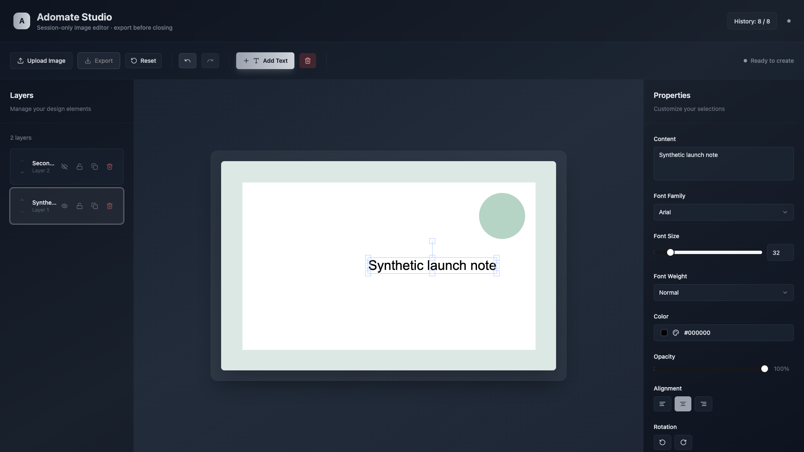
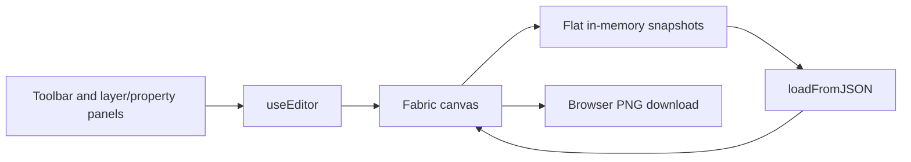

# Image text composer

A browser canvas editor for adding and styling text over a PNG image. Upload an image, edit text layers, arrange their stacking order and export a PNG. The existing interface calls the workspace **Adomate Studio**.



The screenshot comes from the real local editor using a generated geometric PNG and synthetic text. No personal image, account or font API key was used.

## Use the editor

```sh
npm ci --ignore-scripts
npm run dev
```

Open [the workspace](http://localhost:3000). Use Node 22 for the reviewed toolchain; the lockfile retains Next.js 15.4.6, React 18 and Fabric 6.

1. Upload a PNG of up to 8 MiB. Decoded dimensions are limited to 8,192 pixels per side and 32 million pixels overall.
2. Add text, then edit its contents, font, size, weight, color, opacity or alignment.
3. Use the layer panel to select, reorder, hide, lock, duplicate or delete text. Drag/resize/rotate controls operate on the canvas.
4. Undo/redo restores the actual canvas document, not just the layer list. History is capped at 20 snapshots; editing after undo replaces the old redo branch.
5. Export before closing or resetting. **This version is session-only; it does not promise autosave or draft recovery.**

The working preview fits within 800 × 600 while preserving the image aspect ratio. PNG export scales back to the uploaded background dimensions. A verified 1,600 × 1,000 upload exported at 1,600 × 1,000, and an odd 1,577 × 913 fixture also retained its exact dimensions. With no uploaded background, export uses the working canvas dimensions.

Keyboard shortcuts work outside form fields and active text editing: Ctrl/Cmd+Z for undo, Shift+Ctrl/Cmd+Z or Ctrl/Cmd+Y for redo, Ctrl/Cmd+T to add text, Delete/Backspace to delete a selected layer, and arrow keys to nudge it. Shift increases the nudge distance.

## Where the state lives



`src/hooks/use-editor.ts` manages operations and the canvas lifecycle. `src/lib/editor-history.ts` caps history and drops stale redo branches. Fabric serialization includes layer IDs, selection/locking properties and the background; restored snapshots rehydrate the canvas. Layer reordering uses the canvas stack operation without clearing the image.

`src/lib/fabric-utils.ts` creates text and renders PNG exports. Its export boundary handles fractional preview dimensions by overscanning and cropping when Fabric's integer canvas size would otherwise truncate a pixel. The implementation follows Fabric's [serialization guidance](https://www.fabricjs.com/docs/using-custom-properties/) and [canvas API](https://www.fabricjs.com/api/classes/canvas/).

## Fonts and data handling

Core editing works with the built-in Arial, Georgia and Verdana choices. An optional `NEXT_PUBLIC_GOOGLE_FONTS_API_KEY` enables the Google Fonts catalog. That variable is visible in the browser bundle; it is not a place for private credentials. External font loading is bounded and falls back rather than polling forever.

Images are read into the browser canvas; there is no application image-upload backend. Optional Google font requests still contact external font services. Use synthetic images for shared demonstrations. Previous metadata-only localStorage records are not treated as recoverable canvas documents.

## Verification and boundaries

```sh
npm test
npm run build
```

Four Node tests cover flat bounded history, redo-branch replacement, immutable history arrays and invalid limits. A Playwright run against system Chrome exercised upload, text editing, undo, keyboard redo, reordering, visibility, retained background pixels and PNG dimensions. The desktop screenshot was inspected, with no page errors recorded.

The production build type-checks and exports static files to `out/`; serve that directory with a static host/server. `next start` is not the preview mode for this configuration. Linting remains skipped by the existing Next configuration, and legacy Browserslist/tooling warnings remain.

Persistent drafts, large-image/layer-count stress tests, mobile layouts, cross-browser behavior and the live Google Fonts catalog were not verified. Snapshot memory still grows with document/image size despite the history cap. The prototype does not claim collaboration, a tested “unlimited layers” capacity or production-grade recovery. No license file is included, so the previous unsupported MIT claim was removed.
