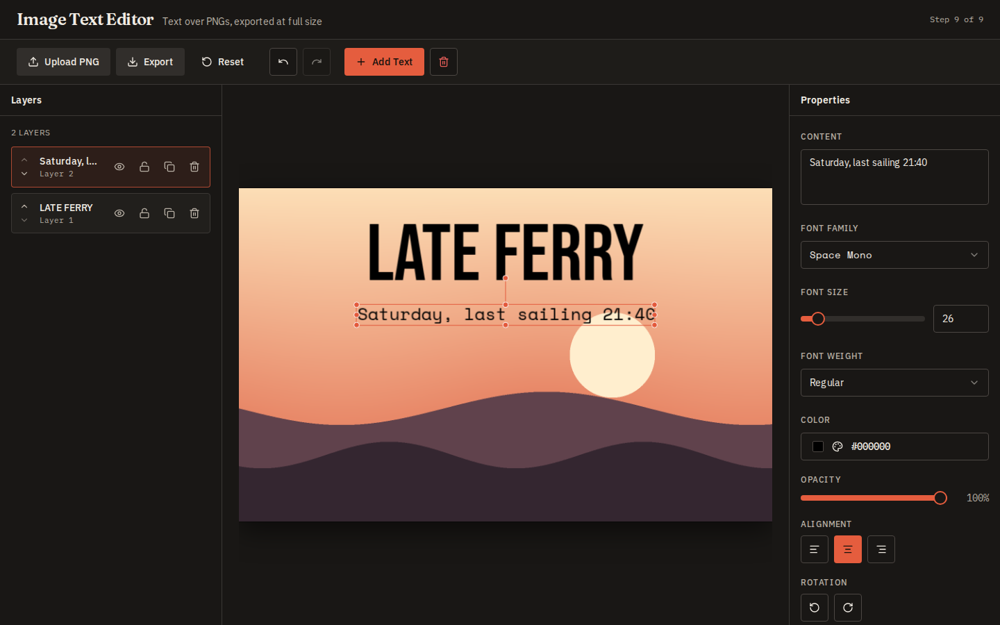
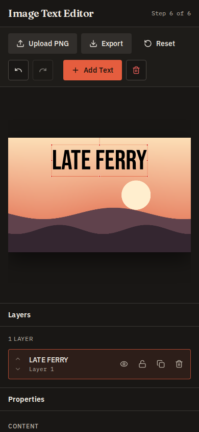
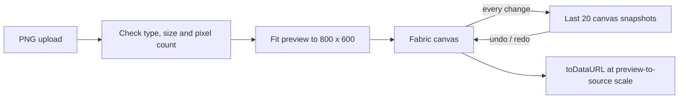

# Image Text Editor

Put captions on a PNG in the browser and download the result at the image's own resolution. Upload a picture, add as many text layers as you need, style each one, and export. There is no backend: the image never leaves the page.



## What it does

- **Upload a PNG** (up to 20 MB and 16 megapixels). The preview is fitted to 800 × 600; the export goes back to the source size.
- **Text layers**, each with its own content, font, size (8–200), weight, colour, opacity, alignment and 15° rotation steps. Layers snap to the canvas centre lines while you drag them.
- **Layers panel**, listed top layer first: bring forward or send backward (buttons or drag and drop), hide, lock, duplicate and delete.
- **Undo and redo** across the last 20 changes, background image included.
- **Export** a PNG at the uploaded image's dimensions, whatever the screen's pixel density.
- **Fonts**: four system families plus 64 curated Google Fonts, loaded only when picked. No API key is needed; see [Fonts](#fonts).
- **Phone layout**: below 1024 px the panels stack under the canvas, which is scaled to fit the screen.

| Keys | Action |
| --- | --- |
| Ctrl/Cmd + Z | Undo |
| Ctrl/Cmd + Shift + Z, or Ctrl/Cmd + Y | Redo |
| Delete or Backspace | Delete the selected layer |
| Arrow keys (Shift for 10 px) | Nudge the selected layer |

Shortcuts are ignored while you type in a field or edit text on the canvas.



## Running it

### With Docker

```bash
docker compose up --build
```

Then open http://localhost:3900. The image builds the static export with Node 22 and serves it from nginx.

### With Node

Node 22 is pinned in `.nvmrc` and `engines`.

```bash
npm ci
npm run dev        # http://localhost:3000
```

`npm run build` writes the static site to `out/`, which any static file server can host.

## Checks

```bash
npm run lint       # ESLint 9 with the Next.js rules
npm test           # Vitest: undo history, preview sizing, font helpers
```

Browser checks drive the built site in headless Chromium. They serve `out/` themselves and need no network:

```bash
npm run build
python3 -m venv .test-venv
.test-venv/bin/pip install -r tests/requirements.txt
.test-venv/bin/python -m playwright install chromium
.test-venv/bin/python tests/browser_checks.py
```

They upload a generated PNG and then check:

- the background covers the whole canvas;
- exports keep the source size on a retina screen;
- undo and redo restore the exact pixels;
- a new edit clears the redo branch;
- the properties panel follows the selected layer;
- a nudged layer can still be clicked;
- non-PNG uploads get an inline error;
- on a 390 px phone the page doesn't scroll sideways, and tapping the scaled canvas selects text;
- no console errors occur.

`--capture` also regenerates the screenshots in `docs/screenshots/` from a generated scene. Capturing needs Google Fonts.

## How it works



- **Two sizes for one canvas.** Fabric draws into a preview-sized buffer, and export multiplies by `source width / preview width` with retina scaling switched off. The download therefore matches the upload even on a 2× or 3× screen. On narrow screens only the canvas's CSS size shrinks (`setDimensions(..., { cssOnly: true })`); Fabric maps pointer positions through that scale, so the editing coordinates do not change.
- **History is whole-canvas snapshots.** Each step stores Fabric's JSON, including the background image, so undo restores pixels rather than just the sidebar. Identical consecutive snapshots are skipped, and edits made after an undo drop the redo branch (`src/lib/history.ts`). Slider and typing changes are debounced, so a drag records one step.
- **Fonts load on demand.** Picking a Google font adds its stylesheet and waits for the face before Fabric re-measures the text. System fonts need no download.
- **Static export.** `next.config.js` sets `output: 'export'`, so production is a folder of files and the container is plain nginx.

## Fonts

Without configuration the picker offers Arial, Georgia, Courier New, Impact and the families in `src/lib/curated-fonts.ts`. These are loaded from the public `fonts.googleapis.com/css2` endpoint, which needs no key. To list the whole Google Fonts catalogue instead, copy `.env.example` to `.env.local` and set `NEXT_PUBLIC_GOOGLE_FONTS_API_KEY` before `npm run dev` or `npm run build`. The value is compiled into the client bundle, so use a key restricted to the Web Fonts API and your domain.

## Project layout

```
src/app/                  page shell, layout, theme
src/components/editor/    toolbar, canvas, layers panel, properties panel
src/components/ui/        the shadcn/ui primitives in use
src/hooks/use-editor.ts   canvas state, history, layer actions
src/lib/                  Fabric helpers, history, preview sizing, fonts (+ unit tests)
tests/browser_checks.py   Playwright checks against the built site
```

## Limitations

- Only PNG uploads are accepted.
- Nothing is saved: reloading the page clears the design.
- Each history step holds a copy of the background image, which is why history stops at 20 steps and uploads at 16 megapixels.
- Google Fonts need a connection. Offline, picked fonts fall back to the browser default, but the editor still works.
- Text colour is chosen with a picker; there is no field for typing a hex value.

## License

[MIT](LICENSE)
